# Motor Insurance Pricing: Risk Modelling and Cross-Subsidy Analysis

End-to-end pricing analysis of 678,013 French motor insurance policies in two parts: risk modelling and a technical premium in **Python**, and a pricing adequacy dashboard in **Power BI**.

In this project, I cleaned and validated policy and claims data, found what drives how often customers claim and how much their claims cost, tested which statistical models fit the data, built a risk-based price for every policy, challenged it with a machine-learning model, and measured how much premium is shifted between customers under simpler tariffs. I then built a five-page Power BI dashboard so pricing managers can explore the results themselves.

> **Business context:** I approached this as a pricing analyst at a motor insurer. Management suspects that some customers pay far less than they cost while others pay far more. Overcharged low-risk customers leave for competitors and undercharged high-risk customers stay, so the portfolio gets steadily worse (adverse selection).

> **Note on the data:** the dataset contains claims but **no premiums**. To measure cross-subsidy, I compared three simulated tariffs: a flat price, a bonus-malus-only price (treated as the "current tariff") and the risk-based GLM price. All three are set to collect the same total, so they differ only in *who* pays.

**Tools:** Python (pandas, NumPy, SciPy, statsmodels, scikit-learn, Matplotlib) in Google Colab (Part A) · Power BI Desktop (Power Query, DAX, star schema data model) (Part B)

**Python Notebook (Part A):** [Click Here](./Insurance_Pricing_Analysis.ipynb)

**Power BI Dashboard (Part B):** [PDF (all pages)](./Insurance_Dashboard.pdf) · [Dashboard overview](#power-bi-dashboard-part-b)

---

## Contents

- [Motor Insurance Pricing: Risk Modelling and Cross-Subsidy Analysis](#motor-insurance-pricing-risk-modelling-and-cross-subsidy-analysis)
  - [Contents](#contents)
  - [Business questions](#business-questions)
  - [Executive summary](#executive-summary)
  - [Dataset](#dataset)
  - [Data cleaning and validation](#data-cleaning-and-validation)
  - [Key definitions](#key-definitions)
  - [Methodology](#methodology)
  - [Findings](#findings)
    - [1. Portfolio risk profile](#1-portfolio-risk-profile)
    - [2. What drives claim frequency and cost](#2-what-drives-claim-frequency-and-cost)
    - [3. Choosing the right models](#3-choosing-the-right-models)
    - [4. Risk-based technical premium and GBM challenger](#4-risk-based-technical-premium-and-gbm-challenger)
    - [5. Pricing adequacy and cross-subsidy](#5-pricing-adequacy-and-cross-subsidy)
  - [Power BI dashboard (Part B)](#power-bi-dashboard-part-b)
    - [Data model](#data-model)
    - [Page 1: Portfolio Overview](#page-1-portfolio-overview)
    - [Page 2: Risk Drivers](#page-2-risk-drivers)
    - [Page 3: Model Performance](#page-3-model-performance)
    - [Page 4: Pricing Adequacy and Cross-Subsidy](#page-4-pricing-adequacy-and-cross-subsidy)
    - [Page 5: Risk-Based Pricing](#page-5-risk-based-pricing)
  - [Recommendations](#recommendations)
  - [Limitations](#limitations)
  - [Repository structure](#repository-structure)

---

## Business questions

1. **Portfolio risk profile:** What does the portfolio look like, and how are claims and claim costs distributed?
2. **Risk drivers:** Which customer and vehicle characteristics drive how often customers claim (frequency) and how much each claim costs (severity)?
3. **Model selection:** Which statistical models fit claim counts and claim costs, and can the choice be justified?
4. **Technical premium:** What is the expected claims cost (pure premium) for each policy? Does a machine-learning challenger find patterns the GLM misses?
5. **Pricing adequacy and cross-subsidy:** Which segments are subsidised or overcharged under the current tariff, and by how much?

---

## Executive summary

| Area | Headline |
|---|---|
| **Portfolio** | 678,013 policies covering 358,360 policy-years; 95% of policies had no claim. Claim costs are extremely skewed: **median EUR 1,172 vs mean EUR 2,266**, and the part of claims above EUR 16,451 (the top 1%) makes up **30.7% of total claim cost**. |
| **Risk drivers** | **Vehicle age, bonus-malus and driver age** drive how often customers claim (spreads of 4.81×, 2.77× and 1.80×). How much a claim costs barely varies between customers: only driver age and region matter, and by at most 1.35×. |
| **Models** | A **negative binomial GLM** for claim counts (mild overdispersion) and a **Gamma GLM** for claim costs, which predicts the average cost within 0.2%. The lognormal model fitted the shape of costs better but **overstated the average by 8.9%**, so it was rejected. |
| **Technical premium** | Expected claims cost ranges from **EUR 112 to EUR 735 per year** (5th to 95th percentile, 6.6×). On unseen policies, actual ÷ expected total cost is **0.985**, and actual cost rises **6.4× from the safest to the riskiest 10%**. |
| **GBM challenger** | A gradient boosting model ranks risk better (Gini **0.350 vs 0.298**). The GLM's largest errors involve **new vehicles**. |
| **Cross-subsidy** | Under the bonus-malus-only tariff, **EUR 15.0M a year (17.7% of premium)** is shifted between customers. **New vehicles pay only 0.29 of their expected cost**, while customers at the maximum bonus pay 1.10 times theirs. |
| **Real claims check** | On unseen policies, loss ratios under the bonus-malus tariff run from **0.47 for the safest 10% to 2.01 for the riskiest 10%**; under the GLM, they stay between **0.93 and 1.05**. |
| **Adverse selection** | If customers overcharged by more than 20% left for a risk-based competitor, the remaining book would need a **29.4% price rise** to break even. |

**Top priorities:** move from bonus-malus-only pricing to the risk-based GLM tariff (phasing in large increases), rate new vehicles properly, make the bonus-malus scale steeper, and use the GBM as an ongoing challenger to find what the tariff misses.

---

## Dataset

[French Motor Third-Party Liability (freMTPL2)](https://www.openml.org/search?type=data&id=41214), a real portfolio from a French insurer, widely used in actuarial research. Loaded directly from OpenML in the notebook.

| Table | Rows | Contents |
|---|---|---|
| `freMTPL2freq` ([OpenML 41214](https://www.openml.org/search?type=data&id=41214)) | 678,013 policies | Policy ID, number of claims, exposure (years insured), driver age, bonus-malus coefficient, vehicle age, power, brand and fuel, area, population density, region |
| `freMTPL2sev` ([OpenML 41215](https://www.openml.org/search?type=data&id=41215)) | 26,639 claims | Policy ID and claim amount (EUR) |

The two tables are joined on `IDpol`. The data was split **80/20 into training and test sets** (542,410 and 135,603 policies), stratified by whether a policy had a claim; all models were checked on the test set they never saw.

---

## Data cleaning and validation

| Issue | Rows | Action |
|---|---|---|
| Exposure above 1 year (a one-year dataset) | 1,224 (0.18%) | Capped at 1 year |
| Claims with no matching policy | 195 | Removed, leaving 26,444 claims with a cost |
| Policies with reported claims but no recorded cost | 9,117 | Kept for frequency (all reported claims count). The missing costs are **not random**: their share varies from 15% to 53% by region (Cramér's V 0.09–0.16), so dropping them would understate frequency |
| More than 4 claims on one policy (up to 16) | 9 | Capped at 4 for modelling |
| Very large claims (up to EUR 4,075,400) | 265 claims above EUR 16,451 | Capped in the severity model; the cost above the cap is added back as a large-claim loading |
| Extreme ages (driver over 90; vehicle over 30, including a placeholder value of 100) | 401 / 1,116 | Kept (rare but possible), with bands so they don't distort results |

I also ran policy–claim join checks, and confirmed that the 80/20 split kept the same claim rate and average cost in both sets.

---

## Key definitions

| Term | Meaning |
|---|---|
| **Exposure / policy-year** | Time insured. A policy held for 6 months counts as 0.5 policy-years. |
| **Claim frequency** | Claims per policy-year (how often customers claim). |
| **Claim severity** | Average cost per claim. |
| **Pure premium (technical premium)** | Expected claims cost per policy-year = frequency × (severity + large-claim loading). The fair price before expenses and profit. |
| **Bonus-malus** | The French no-claims coefficient: everyone starts at 100, it falls 5% for each claim-free year to a floor of 50, and rises 25% for each at-fault claim. |
| **Relativity** | How much more (or less) a group claims than the reference group. For example, 1.60 = 60% more. |
| **Spread** | Highest ÷ lowest relativity across a factor's credible levels; a quick measure of how much a factor matters. |
| **AIC** | A measure of model fit that penalises extra parameters. Lower is better; a difference above 10 is strong evidence ([Burnham & Anderson, 2002](https://link.springer.com/book/10.1007/b97636)). |
| **Gini** | How well a price ranks customers by risk: 0 = no better than random (a flat price), higher = better. |
| **Actual ÷ expected (A/E)** | Actual claims ÷ predicted claims. 1.00 = the total is predicted exactly. |
| **Loss ratio** | Actual claims cost ÷ premium. Below 1 = the group pays more than it costs; above 1 = it costs more than it pays. |
| **Cross-subsidy** | Premium paid by overcharged customers that covers the cost of undercharged customers. |

---

## Methodology

- **Risk drivers (one factor at a time):** relativities for every rating factor, a **likelihood-ratio test** for frequency and **Kruskal–Wallis** with effect size (ε²) for severity. A factor counts as a **material driver** if its spread is at least 1.25× and p < 0.01 (with a sensitivity check of the threshold). Levels with too few claims for a reliable estimate were excluded from the spread, using the standard credibility rule of 1,082 claims. **Cramér's V** measured overlap between factors, and a heatmap checked how driver age and bonus-malus interact.
- **Distribution testing before modelling:** variance vs mean of claim counts (dispersion), observed vs Poisson-expected counts, a **mean excess plot** to choose the large-claim cap, maximum-likelihood fits of four severity distributions with **QQ plots and AIC**, and the mean–variance relationship across segments.
- **Model selection:** Poisson vs negative binomial vs zero-inflated Poisson for frequency, and Gamma vs inverse Gaussian vs lognormal for severity. Compared on AIC/BIC, test-set log-likelihood and deviance, the Cameron–Trivedi and Vuong tests, and **whether each model reproduces the average cost**.
- **Technical premium:** factors were kept only if removing them worsened AIC by more than 10 points **and** p < 0.01. Large claims were priced as a loading per expected claim.
- **Validation on unseen policies:** actual ÷ expected, a lift chart by risk decile, and the Gini index.
- **Challenger model:** a gradient boosting model (scikit-learn `HistGradientBoostingRegressor`, Poisson and Gamma loss) compared with the GLM on test-set deviance (with 95% intervals), Gini (bootstrap interval) and a **double-lift chart** showing who is right where they disagree.
- **Cross-subsidy:** flat, bonus-malus-only and GLM tariffs, each scaled to collect the same total; premium compared with expected cost by segment and by risk decile; loss ratios checked against **actual claims** on unseen policies; and an **adverse selection scenario** in which overcharged customers leave.

Significance level: p < 0.01 for factor selection; 95% intervals for model comparisons.

---

## Findings

### 1. Portfolio risk profile

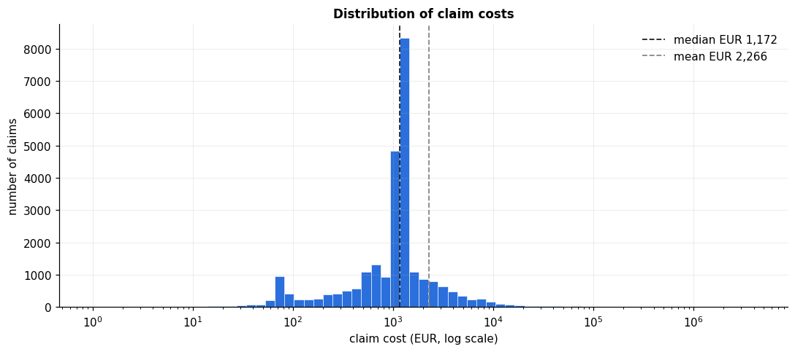

*Claim cost percentiles (costed claims)*

| Percentile | Claim cost (EUR) |
|---|---|
| 25th | 686 |
| Median | 1,172 |
| 75th | 1,212 |
| 90th | 2,768 |
| 99th | 16,451 |
| 99.9th | 152,223 |
| Maximum | 4,075,401 |

- **Claim costs are extremely skewed:** the mean (EUR 2,266) is almost double the median (EUR 1,172), and the largest claim is EUR 4.1M.
- **A fixed-amount spike:** 19.0% of claims fall within ±2% of EUR 1,204, which suggests standard settlement amounts.
- **Large claims dominate cost:** the part of claims above EUR 16,451 (the top 1%) makes up 30.7% of total claim cost, so they are priced separately through a loading.
- **Most customers are at the maximum bonus:** 62.8% of policy-years are at bonus-malus 50. Drivers aged 41–50 are the largest age group (24.6%); drivers aged 18–20 are only 0.7%.
- **95% of policies had no claim** during the year.

### 2. What drives claim frequency and cost

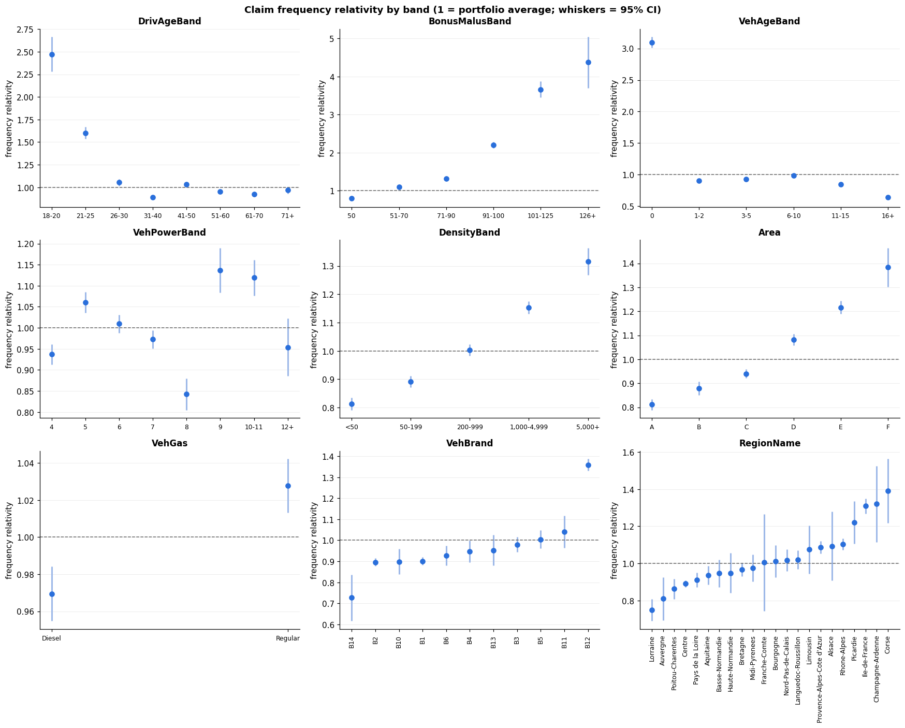

*How much each factor changes claim frequency (one factor at a time)*

| Factor | Spread | Highest | Lowest |
|---|---|---|---|
| **Vehicle age** | **4.81×** | New vehicles: 3.10× | 16+ years: 0.64× |
| **Bonus-malus** | **2.77×** | 91–100: 2.20× | 50 (maximum bonus): 0.80× |
| **Driver age** | **1.80×** | 21–25: 1.60× | 31–40: 0.89× |
| Region | 1.75× | | |
| Area | 1.71× | | |
| Population density | 1.62× | | |
| Vehicle brand | 1.52× | | |
| Vehicle power | 1.35× | | |
| Fuel type | 1.06× | | |

- **Frequency varies far more than cost.** Every factor except fuel type passes the material-driver rule for frequency.
- **Claim cost barely varies between customers.** Only **driver age** (spread 1.35×; drivers aged 18–20 cost 1.30× per claim) and **region** (1.27×; Provence-Alpes-Côte d'Azur 1.17×) pass the rule, and only driver age stays material at a stricter 1.30× threshold.
- **Some factors overlap:** area and population density measure almost the same thing (Cramér's V 0.77), so only one is used in the model.

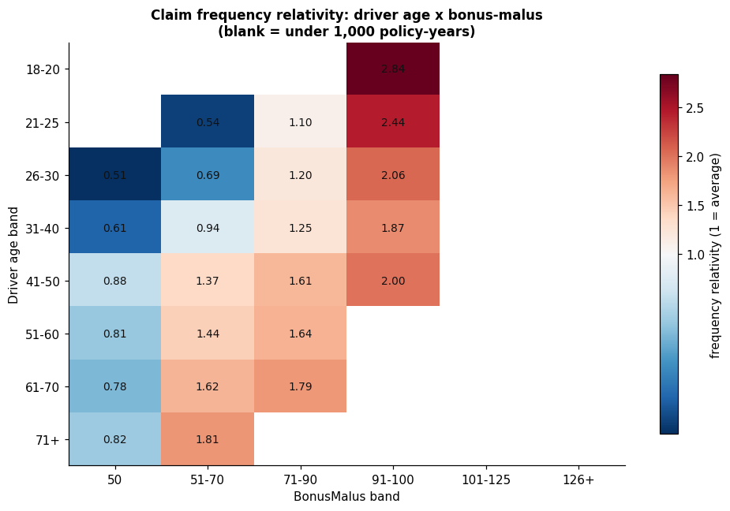

- **Bonus-malus and driver age interact.** Within every age band, frequency rises with the bonus-malus coefficient. But young drivers at the maximum bonus have unusually low frequency, and some combinations are implausible (163 policy-years of drivers aged 18–20 at bonus-malus 50, which normally takes about 13 claim-free years to reach).

### 3. Choosing the right models

*Claim frequency (test set)*

| Model | AIC (train) | Log-likelihood (test) | Mean deviance (test) |
|---|---|---|---|
| Poisson | 225,433.7 | −28,144.4 | 0.31281 |
| **Negative binomial** | **224,981.2** | **−28,075.8** | 0.31287 |
| Zero-inflated Poisson | 225,054.1 | −28,089.0 | 0.31285 |

- **Mild overdispersion:** full-year policies are close to Poisson (dispersion 1.015), but repeat claims are under-predicted by Poisson, and the negative binomial fits clearly better (AIC 452.6 points lower).
- **No excess of zero-claim policies** (observed ÷ expected 1.001), so the zero-inflated model was not chosen.
- **All three predict average claim counts almost identically,** and in the final model the negative binomial and Poisson relativities differ by at most 5%. The choice does not change prices.

*Claim cost (test set, claims capped at EUR 16,451)*

| Model | AIC (train) | Log-likelihood (test) | Predicted ÷ actual average cost |
|---|---|---|---|
| **Gamma GLM** | 359,632.3 | −45,203.8 | **1.002** |
| Inverse Gaussian GLM | 367,944.7 | −46,121.0 | 1.003 |
| Lognormal | **352,844.8** | **−44,326.4** | 1.089 |

- **The lognormal fits the shape of claim costs best but overstates the average cost by 8.9%**; without its back-transformation correction it would understate it by 40%. Because a premium depends on the average cost, **the Gamma GLM was chosen**: it predicts the average within 0.2% and beats the inverse Gaussian on every measure.
- **No distribution fits perfectly,** because of the fixed-amount spike.

### 4. Risk-based technical premium and GBM challenger

**Final models**

- **Frequency (negative binomial GLM):** all 8 rating factors are needed; the strongest are vehicle age and bonus-malus (removing them worsens AIC by 3,850 and 2,991 points). Area was kept over population density, and a **driver age × bonus-malus interaction** was added (AIC gain 64.0).
- **The interaction shows the maximum bonus means less for young drivers:** compared with drivers aged 41–50, drivers aged 21–25 at bonus-malus 50 claim 2.13× more than the main factors suggest, while drivers aged 71+ claim 0.71×.
- **Severity (Gamma GLM):** driver age, region and vehicle age. No other factor passed both tests.

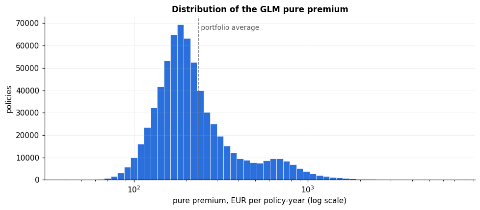

*Pure premium per policy-year*

| | EUR per year |
|---|---|
| Portfolio average | 237 |
| 5th percentile | 112 |
| Median | 197 |
| 95th percentile | 735 |
| 99th percentile | 1,216 |

- **Worked example:** a typical policy (driver aged 54, maximum bonus, 8-year-old car) is expected to have 0.0891 claims a year at EUR 1,474 each, plus a large-claim loading of EUR 743 per claim: 0.0891 × (1,474 + 743) = **EUR 197 a year**.
- **Price differences come mainly from frequency:** the high-risk example (a new vehicle) has 0.3063 expected claims a year vs 0.0521 for the low-risk example, while its cost per claim is only EUR 1,657 vs EUR 1,411.

**Validation on unseen policies**

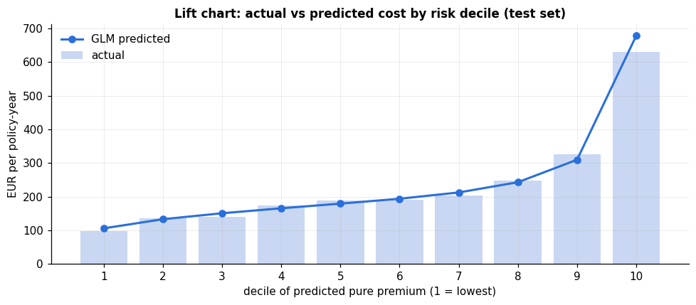

| Check (test set) | Result |
|---|---|
| Actual ÷ expected: claim frequency | 0.988 |
| Actual ÷ expected: cost per claim | 0.999 |
| Actual ÷ expected: total cost | 0.985 |
| Actual cost, safest vs riskiest 10% | EUR 98 vs EUR 631 per year (6.4×) |
| Gini | 0.298 |

- **The premium predicts total cost within 1.5% and ranks risk well:** actual cost rises in every decile, and actual ÷ predicted stays between 0.93 and 1.06.

**GBM challenger**

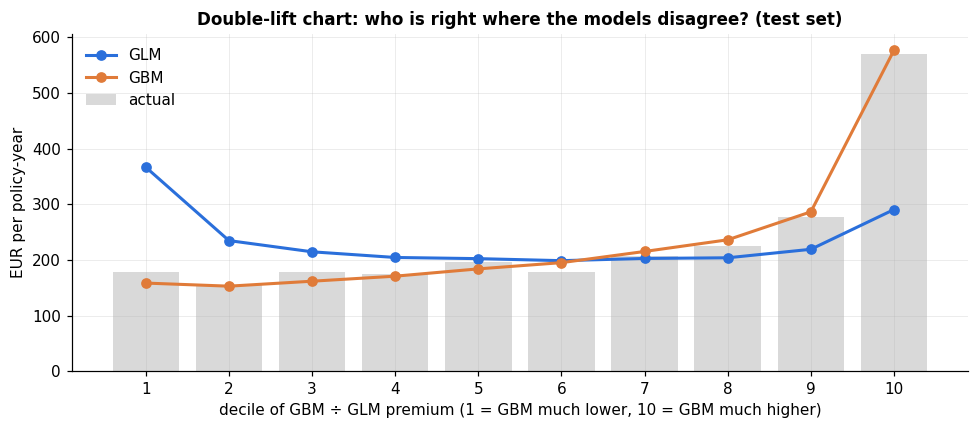

| Measure (test set) | GLM | GBM | Difference (95% interval) |
|---|---|---|---|
| Frequency deviance (lower = better) | 0.3128 | **0.3018** | −0.0110 (−0.0123 to −0.0098) |
| Severity deviance (lower = better) | **1.0317** | 1.0353 | +0.0036 (−0.0034 to +0.0107) |
| Gini (higher = better) | 0.298 | **0.350** | +0.052 (+0.040 to +0.067) |

- **The GBM predicts claim frequency and ranks risk clearly better,** but adds nothing for claim cost.
- **Where the two disagree, the GBM is closer to actual cost in 8 of 10 deciles.** In the most extreme 10% at each end, the GLM charges about **twice** (decile 1) or **half** (decile 10) the actual cost.
- **The disagreement centres on new vehicles:** 34.9% and 17.4% of the policies in the two extreme deciles are new vehicles, against 8.7% overall. The GLM applies one high multiplier to every new vehicle, while the GBM finds that new-vehicle risk varies widely with other characteristics.
- **The GLM remains the tariff** because every price can be explained as a short list of multipliers. The GBM's role is to show where the GLM needs refining.

### 5. Pricing adequacy and cross-subsidy

All three tariffs collect the same **EUR 84.8M**. The flat tariff charges everyone EUR 237 a year; the bonus-malus tariff charges EUR 409 × the customer's coefficient (EUR 205 at the maximum bonus, up to EUR 942); the GLM ranges from EUR 40 to EUR 7,082.

*How much premium is shifted between customers*

| Tariff (vs GLM expected cost) | Premium shifted | % of premium | Overcharged by >20% | Undercharged by >20% |
|---|---|---|---|---|
| Flat | EUR 18,550,465 | 21.9% | 57.0% of policy-years | 15.8% |
| **Bonus-malus only** | **EUR 14,988,050** | **17.7%** | **48.6%** | **11.3%** |

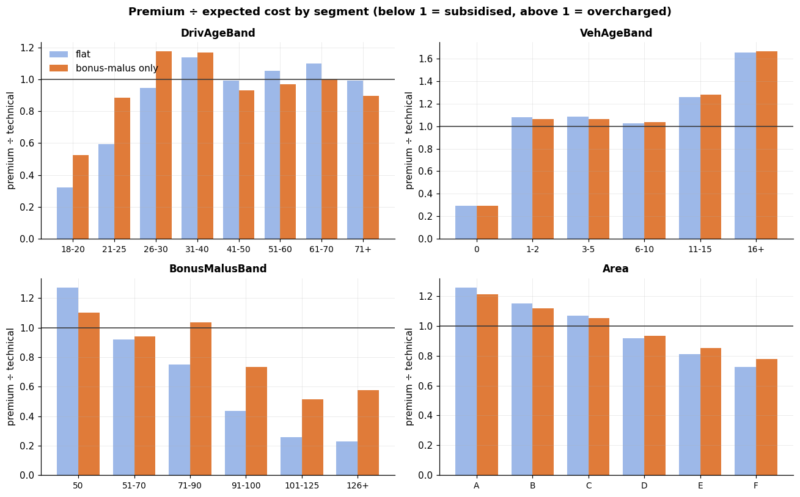

*Largest transfers under the bonus-malus tariff*

| Segment | Pays (÷ expected cost) | Net transfer per year |
|---|---|---|
| **New vehicles** | **0.29** | **−EUR 9.58M** (subsidised) |
| Brand B12 | 0.71 | −EUR 6.36M |
| Area E (dense) | 0.85 | −EUR 2.79M |
| Bonus-malus 91–100 | 0.73 | −EUR 1.96M |
| Bonus-malus 50 (maximum bonus) | 1.10 | +EUR 4.20M (overcharged) |
| Vehicles aged 11–15 | 1.28 | +EUR 4.08M |
| Centre region | 1.15 | +EUR 3.07M |
| Drivers aged 31–40 | 1.17 | +EUR 2.95M |
| Vehicles aged 16+ | 1.66 | +EUR 2.87M |

- **Claims history alone cannot correct the largest subsidies,** because it says nothing about vehicle age, brand or location. New vehicles receive a subsidy equivalent to 64% of all premium shifted.
- **The bonus-malus scale is too flat:** customers at the maximum bonus (62.8% of the portfolio) pay 10% more than their expected cost, while customers with a malus pay only half to three-quarters of theirs.

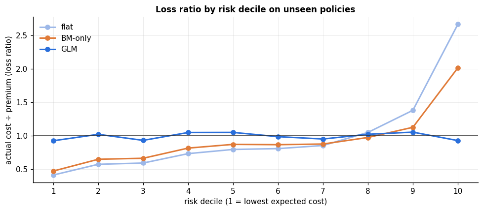

*Actual claims on unseen policies: loss ratio by risk decile*

| Risk decile | Flat | Bonus-malus only | GLM |
|---|---|---|---|
| 1 (safest 10%) | 0.41 | 0.47 | 0.93 |
| 5 | 0.80 | 0.87 | 1.05 |
| 10 (riskiest 10%) | **2.66** | **2.01** | **0.93** |
| Overall | 0.987 | 0.988 | 0.985 |

- **Real claims confirm the cross-subsidy:** under the bonus-malus tariff, the safest customers' claims cost less than half their premium, while the riskiest customers' claims cost twice theirs. Under the GLM, every decile stays between 0.93 and 1.05.
- **New vehicles** have an actual loss ratio of **3.06** under both simpler tariffs, vs 0.89 under the GLM.

*Adverse selection scenario: customers overcharged by more than a threshold leave*

| Tariff | Leave if overcharged by more than | Policy-years lost | Price rise needed to break even |
|---|---|---|---|
| Bonus-malus only | 10% | 61.5% | +42.4% |
| **Bonus-malus only** | **20%** | **48.6%** | **+29.4%** |
| Bonus-malus only | 30% | 37.3% | +20.8% |
| Flat | 20% | 57.0% | +47.2% |

- **A competitor pricing by risk would take the most profitable customers,** leaving a book that needs a large price rise, which would push even more customers away.

---

## Power BI dashboard (Part B)

📊 [Open the dashboard as a PDF](./Insurance_Pricing_Dashboard.pdf)

The dashboard turns the notebook's results into five pages a pricing manager can explore: switch between tariffs, pick any rating factor, and see who pays for whom. It reads the CSV files exported at the end of the notebook (Section 7).

| Page | Business question | What a stakeholder can do |
|---|---|---|
| 1. Portfolio Overview | Q1: What does the portfolio look like? | Filter by region, area, driver age and fuel; see claim frequency, cost per claim and cost concentration |
| 2. Risk Drivers | Q2: What drives frequency and severity? | Pick any rating factor and compare actual vs predicted claims |
| 3. Model Performance | Q4: Does the premium predict and rank risk? | See the GLM's rating factor multipliers, its accuracy on unseen policies, and where the GBM does better |
| 4. Pricing Adequacy and Cross-Subsidy | Q5: Who is subsidised, and by how much? | Switch between the flat, bonus-malus and GLM tariffs and see the cross-subsidy by segment |
| 5. Risk-Based Pricing | Q5: What happens if we move to the GLM? | See how many customers' prices would rise or fall, and the risk of doing nothing |

### Data model

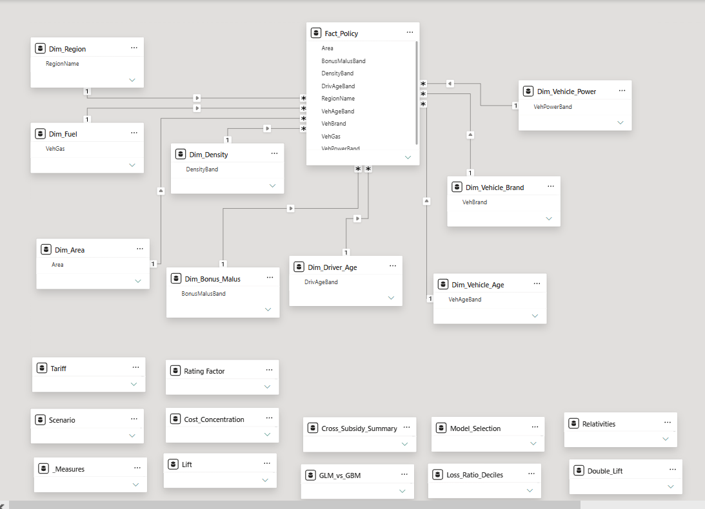

- **Star schema:** one fact table (`Fact_Policy`, 678,013 rows, one per policy) connected to nine dimension tables (driver age, bonus-malus, vehicle age, vehicle power, brand, fuel, area, density, region). Each dimension has a sort-order column, so bands always display in their natural order.
- **Separate summary tables** hold results that only Python can produce: GLM relativities, the GLM vs GBM comparison, lift and double-lift deciles, the adverse selection scenario and claim cost concentration.
- **33+ DAX measures**, created in bulk with a TMDL script and grouped into display folders: portfolio KPIs, model predictions, tariffs, cross-subsidy, test-set loss ratios and dislocation.
- **Interactivity:** a **tariff selector** (one set of visuals switches between flat, bonus-malus and GLM pricing) and a **rating-factor field parameter** (one chart switches between all nine factors).
- **Checked against the notebook:** total premium (EUR 84,791,890), premium shifted (EUR 14,988,050) and test-set loss ratios match the Python results.

### Page 1: Portfolio Overview

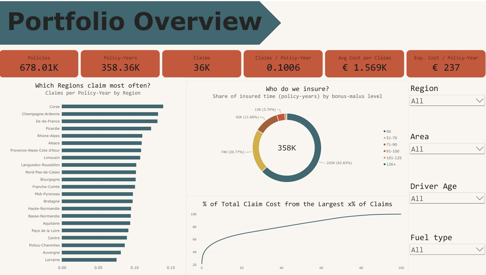

- **KPI cards:** policies, policy-years, claims, claim frequency, average cost per claim and expected claims cost per policy-year.
- **Frequency by region** and the **portfolio mix by bonus-malus level**, showing that most insured time is at the maximum bonus.
- **Claim cost concentration:** the share of total cost coming from the largest claims, which is why large claims are priced separately.

### Page 2: Risk Drivers

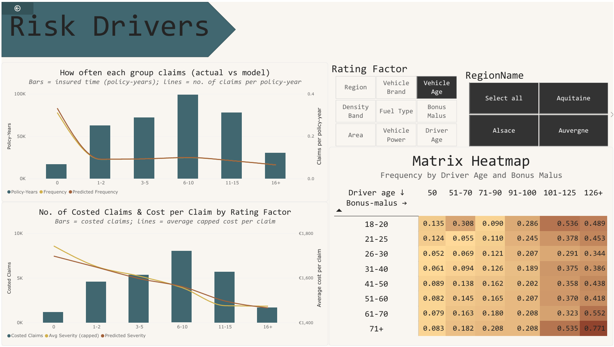

- **One-way charts for any rating factor:** insured time (bars) with actual and model-predicted claim frequency (lines). The two lines track closely, showing the model follows the real pattern.
- **Cost per claim by factor:** changes far less between groups than frequency does, so most price differences come from how often customers claim.
- **Driver age × bonus-malus heatmap:** frequency rises with bonus-malus at every age, and young drivers claim more at the same bonus-malus level. This justifies the interaction in the model.

### Page 3: Model Performance

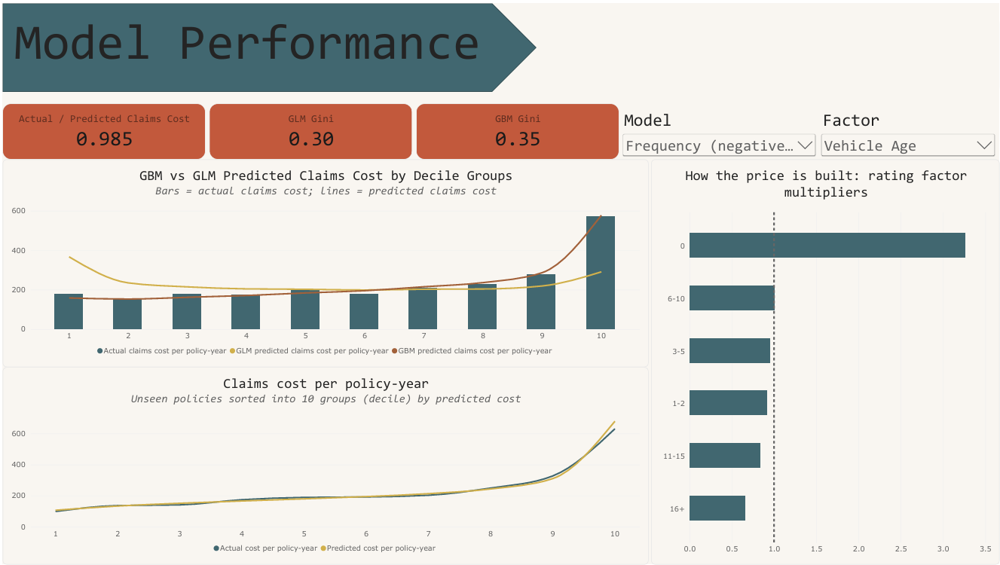

- **Accuracy:** on unseen policies, actual claims cost is 0.985 times the predicted cost.
- **Rating factor multipliers:** how the frequency and severity models price each group (1.00 = the reference customer).
- **Lift chart:** actual claims cost rises from the safest to the riskiest 10% in line with the prediction.
- **GLM vs GBM:** the GBM ranks risk better (Gini 0.350 vs 0.298), and the double-lift chart shows it is closer to actual cost where the two disagree, mainly for new vehicles.

### Page 4: Pricing Adequacy and Cross-Subsidy

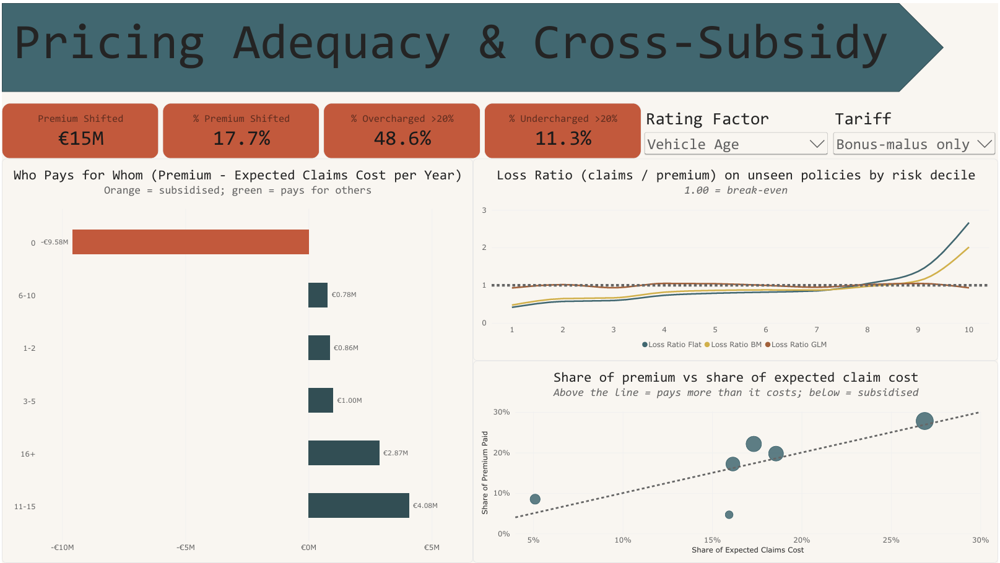

- **Tariff selector and KPI cards:** under the bonus-malus tariff, EUR 15.0M a year (17.7% of premium) is shifted between customers; 48.6% of policy-years are overcharged by more than 20%.
- **"Who pays for whom?":** premium minus expected claims cost for each group of the chosen factor. New vehicles receive a subsidy of EUR 9.6M a year, while customers at the maximum bonus pay EUR 4.2M more than they cost. Under the GLM tariff every bar is zero, because each group pays its expected cost.
- **Fair-share bubble chart:** each group's share of premium vs its share of expected claims cost; groups below the diagonal are subsidised.
- **Loss ratio by risk decile (actual claims, unseen policies):** rises steeply under the flat and bonus-malus tariffs but stays near 1.00 under the GLM.

### Page 5: Risk-Based Pricing

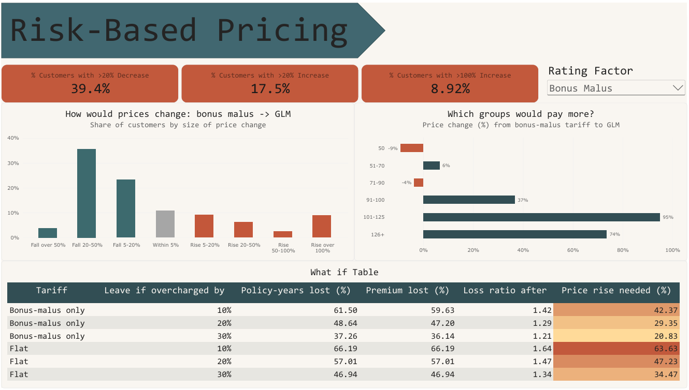

- **Price changes if the insurer moved from the bonus-malus tariff to the GLM:** 39.4% of customers would get a price cut of more than 20%, and 17.5% would face a rise of more than 20%.
- **Which groups would pay more:** new vehicles would see the largest increase (about +243% on average), so changes should be phased in with caps.
- **What-if table:** based on bonus-malus tariff, if customers overcharged by more than 20% left for a risk-based competitor, the remaining book would need a 29.4% price rise to break even.

---

## Recommendations

**Pricing**

1. **Move from bonus-malus-only pricing to the risk-based GLM tariff.** It removes most of the EUR 15.0M a year shifted between customers and keeps loss ratios level across risk groups (0.93–1.05).
2. **Phase in large increases.** Subsidised segments, especially new vehicles (currently paying 0.29 of their cost), would face large rises. Cap year-on-year changes to manage customer reaction and complaints.
3. **Make the bonus-malus scale steeper, and make it depend on age.** Customers at the maximum bonus are overcharged by 10% and customers with a malus are undercharged; young drivers at the maximum bonus claim far more than the discount assumes.
4. **Protect the most profitable customers first.** The overcharged low-risk customers are the ones a risk-based competitor would win; lowering their prices reduces the adverse selection risk.
5. **Price large claims separately and review the loading** (EUR 743 per expected claim) against reinsurance costs.

**Further analysis to improve the model**

1. **Refine new-vehicle rating:** add new-vehicle interactions (e.g. with brand or location), guided by where the GBM disagrees with the GLM.
2. **Treat short policies separately:** test whether policies that have just started need their own adjustment, rather than assuming claims are proportional to time insured.
3. **Use smooth effects instead of bands** for driver age and population density, since the GLM's predictions jump at band boundaries.
4. **Stabilise small segments** (small regions and brands) with penalised GLMs or credibility weighting.
5. **Model large claims by segment** with more years of data, instead of a flat loading per claim.
6. **Investigate claims with no recorded cost,** which are not missing at random and may understate the premium for some segments.
7. **Validate on a later year,** and build the commercial premium (expenses, commission, profit) with a price-sensitivity model to predict retention.

---

## Limitations

- **There are no real premiums in the data,** so the "current tariff" is a simplified bonus-malus-only tariff. Real French tariffs combine the coefficient with other rating factors, so the real cross-subsidy is likely smaller than shown.
- **Expected cost comes from the GLM,** which itself misses some patterns (the GBM found them); the cross-subsidy figures are only as accurate as the technical premium.
- **Claims without a recorded cost** are assumed to cost the same as similar costed claims, although the missing costs are not random.
- **The pure premium covers claims only,** not expenses, commission or profit.
- **No distribution fits claim costs perfectly** because of a fixed-amount spike, and the large-claim cap (99th percentile) is a judgement.
- **The adverse selection scenario is illustrative:** it assumes every overcharged customer above the threshold leaves at once.
- **The data covers one year of one French insurer's portfolio,** so the relativities may not carry over to other markets or years.

---

## Repository structure

```
Insurance-Pricing-Analysis/
├── README.md
├── Insurance_Pricing_Analysis.ipynb
├── Insurance_Pricing_Dashboard.pdf
└── images/
    ├── ins_*.png        (notebook charts)
    └── pbi_*.png        (dashboard screenshots)
```

*The data is not stored in the repository; the notebook loads it directly from OpenML, and Section 7 of the notebook exports the CSV files the dashboard reads.*

---

*Author: Jocelin · [LinkedIn](https://www.linkedin.com/in/jocelin-helsa-418092264/) · [Email](mailto:celinhelsa28@gmail.com)*
